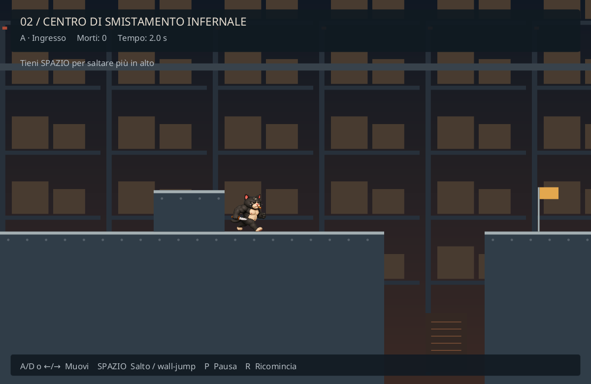
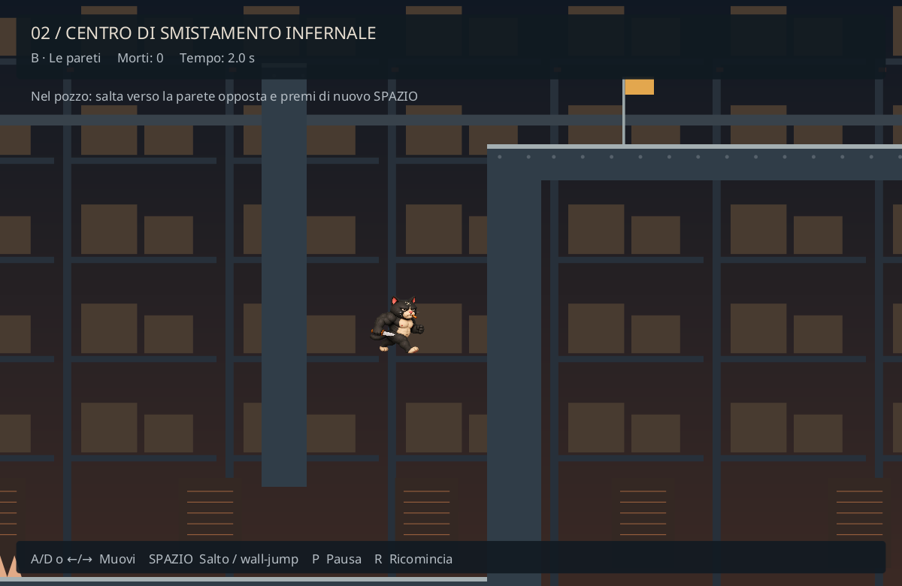
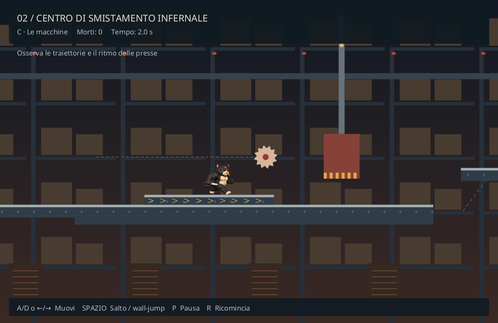
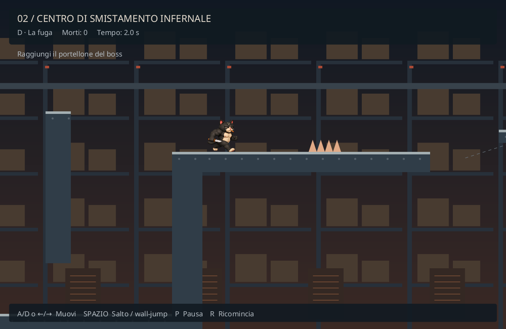

# Livello 2 — Il centro di smistamento infernale

Prima versione platform originale: magazzino industriale su una mappa di 6200 × 1400 unità. Il protagonista usa l'atlante di corsa già presente. Non vengono introdotte risorse esterne né modificati il runner e il combattimento del boss.

## Progressione

`PLAYING → LEVEL_TRANSITION (1,3 s) → PLATFORMER → BOSS_TRANSITION (1,1 s) → BOSS_FIGHT → VICTORY`.

La soglia resta 10.000 punti. Il completamento è registrato da `platformerCompleted`; la morte platform non passa da Game Over. Il boss mantiene energia, scudo, pacco esplosivo, proiettili e durata originali. Le transizioni sono gestite da MasterCat; gli aggiornamenti del vecchio livello terminano immediatamente al cambio di stato.

## Percorso

| Sezione | Coordinate X indicative | Obiettivo |
|---|---|---|
| A — Ingresso | 0–1450 | Gradino, salto variabile, vuoto di 170 unità, punte e primo checkpoint |
| B — Le pareti | 1450–2400 | Ingresso sotto una parete, pozzo di 200 unità, wall-jump concatenati; checkpoint in cima |
| C — Le macchine | 2400–4070 | Piattaforme sospese, sega mobile, nastro che trascina, pressa periodica; checkpoint prima della fuga |
| D — La fuga | 4070–6200 | Secondo pozzo, punte, piattaforma mobile, pressa e sega; portellone verso il boss |

Il nastro è pericoloso per il trasporto verso i macchinari, non per contatto. Le seghe mostrano la traiettoria; le presse hanno un indicatore rosso durante la discesa e ambra durante la risalita. Tutti gli ostacoli hanno movimenti periodici deterministici. Le superfici calpestabili hanno un bordo chiaro, i pericoli una palette calda. Il fondale resta meno contrastato e usa parallasse.

## Dati e responsabilità

- `levels/sorting.csv`: geometria e traiettorie. Ogni riga: `kind,x,y,width,height,travelX,travelY,periodSeconds,beltSpeed`. Origine in alto a sinistra; Y cresce verso il basso. Tipi: solid, moving, belt, saw, press, spikes, checkpoint, exit.
- `PlatformerMap`: caricamento dal classpath e geometrie immutabili.
- `PlatformerConfig`: parametri in unità del mondo e secondi.
- `PlatformerLevel`: controller, collisioni per assi, timer, respawn, checkpoint. Non dipende da JavaFX.
- `PlatformerCamera`: posizione di vista indipendente dalla simulazione.
- `PlatformerRenderer`: ambiente Canvas, gatto esistente, HUD, transizioni. Gli elementi procedurali possono essere sostituiti con texture senza cambiare le collisioni.
- `GameInput`, `GameUpdate`, `MasterCat`: integrazione con gli stati esistenti.

Il cronometro comprende i tentativi e l'effetto di morte, ma esclude la pausa e le transizioni. Il respawn dura 0,22 s, azzera input e velocità e riporta la camera al checkpoint. `R` azzera l'intero secondo livello (morti, tempo, checkpoint e fase macchine); la morte conserva il checkpoint e il tempo. `checkpointsEnabled=false` consente prove senza checkpoint, senza una nuova opzione nel menu.

Il livello riutilizza la musica di gioco; il boss continua a usare la propria traccia. Gli attacchi sono temporaneamente inattivi nel platform; il relativo codice negli altri livelli è conservato.

## Immagini JavaFX

Le immagini seguenti sono snapshot del renderer reale con posizioni impostate per mostrare le sezioni, non prove di un playthrough manuale.

